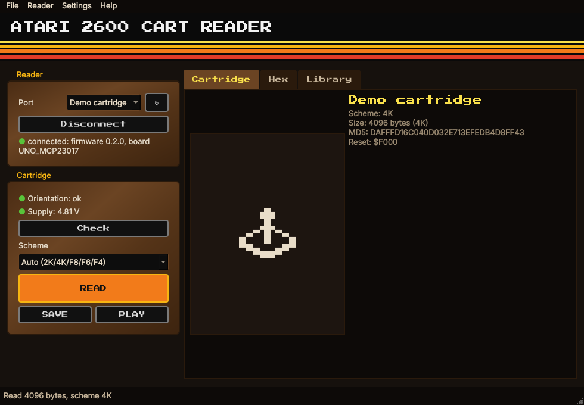

# Atari 2600 Cartridge Reader

Arduino firmware and a PC program (Windows, Linux) for dumping Atari 2600 cartridges, including bankswitched games, and playing them in Stella.

Project page: https://www.fambach.net/ (Retro Projekt – Atari 2600 ROM einlesen)

## Repository layout

| Folder | Content |
|---|---|
| [`firmware/`](firmware/) | Arduino firmware (`AtariCartReader`) |
| [`hardware/`](hardware/) | boards (KiCad, Gerber, BOM), drawings, generator, wish list for the next revision |
| [`3d-print/`](3d-print/) | 3D-printed parts (cartridge guide) |
| [`test/`](test/) | test sketches for a freshly built board |
| [`software/`](software/) | PC program with GUI: read, save, hex view, game collection, Stella start, updates |
| [`tools/`](tools/) | small PC tools (`dump.py`, `sync_config.py`) |

## Boards

| Board | Address bus | Data bus |
|---|---|---|
| Arduino Mega 2560 | A0-A7 = PA0-PA7, A8-A12 = PC0-PC4 | D0-D7 = PL0-PL7 |
| Arduino Uno / Nano | 2 × 74HC595 on SPI (MOSI D11, SCK D13, latch A2): U1 = A0-A7, U2 = A8-A12 | D0-D7 = D2-D9 |
| Uno / Nano, MCP23017 boards | MCP23017 (I2C 0x20): GPA0-7 = A0-A7, GPB0-4 = A8-A12; `#define BOARD_UNO_MCP23017` / `BOARD_NANO_MCP23017` in `config.h` | D0-D7 = D2-D9 |

Cartridge slot: pin 23 = switched +5 V (BC327, LOW on D10 for Uno/Nano, D8 for Mega; sense on A0), pins 12 and 24 = GND. Read button on A1; reset button on the Arduino RESET line (Uno and Mega shields).

Boards (THT, KiCad) for Uno, Mega and Nano, plus MCP23017 variants for Uno and Nano: [`hardware/`](hardware/).

| Board | Status |
|---|---|
| Uno shield MCP23017, revision 1.2 | **tested** (2026-11-15): bus, supply, orientation check, reading 2K/4K/F8 and a 32-in-1 multicart, firmware upload from the PC program |
| Uno shield (74HC595), Mega shield, Nano boards | not built yet |

Firmware: select the board at the top of `firmware/AtariCartReader/config.h` (one `#define BOARD_...`); the same file is copied into the test sketches with `tools/sync_config.py`.

## Bankswitching

| Scheme | Size | Status |
|---|---|---|
| 2K, 4K | 2/4 KB | |
| F8, F6, F4 (+SC) | 8/16/32 KB | |
| E0 (Parker Bros.) | 8 KB | |
| E7 (M-Network) | 16 KB | |
| FA (CBS RAM+) | 12 KB | |
| FE (Activision) | 8 KB | experimental |
| 3F (Tigervision) | 8 KB+ (`D 3F <kb>`) | experimental |

Tested on hardware: 2K, 4K, F8 and the 32-in-1 multicart (Uno shield MCP23017). The other schemes are untested. Board tests to run first: [`test/`](test/).

## Usage

PC program: see [`software/`](software/) (`python -m acr`, or the ready-made program from the releases).



Serial protocol 1, 115200 baud (`SERIAL_BAUD` in `config.h`), one command per line:

| Command | Answer |
|---|---|
| `H` | `HELLO AtariCartReader <version> <board> 1` (also sent after reset) |
| `L` | one `<scheme> <kb>K` per line, then `END` |
| `D <scheme> [kb]` | `OK <bytes>`, the raw bytes, `CRC <crc32 hex>` |
| `S` | `STATUS <data bits hex> <ok\|reversed> <supply ADC or -1>` |
| `P <hexaddr>` | one byte (debug) |

Errors are `ERR <text>`. The read button (A1) repeats the last `D` command (4K until one was given); `dump.py <port> listen <prefix>` saves those dumps. The cartridge is powered only during `D`, `P`, `S` and a button read, and only after the orientation check passed (a reversed cartridge pulls D2 low, see [`hardware/`](hardware/)).

```
pip install pyserial
python3 tools/dump.py /dev/ttyACM0 F8 game.bin
```

## Credits

- [Stella](https://stella-emu.github.io/) (GPL-2), started as an external program
- game titles and covers: [libretro-database](https://github.com/libretro/libretro-database), [libretro-thumbnails](https://github.com/libretro-thumbnails/Atari_-_2600), downloaded on demand
- font [Press Start 2P](https://fonts.google.com/specimen/Press+Start+2P) (SIL OFL 1.1)

- [retrocartdumper](https://github.com/SvOlli/retrocartdumper) by Sven Oliver Moll (GPLv3)
- [Cart Reader](https://github.com/sanni/cartreader) by sanni (GPLv3)
- [vcsreaderfw](https://github.com/keoni29/vcsreaderfw) by Koen van Vliet (MIT)

## Authors

- **Stefan Fambach** (SteFam) – idea and concept, review and testing – https://www.fambach.net
- **Claude** (Anthropic AI) – implementation, via Claude Code

## AI disclosure

This project is built with AI assistance. Stefan Fambach had the idea, wrote the concept and reviews and tests every change; the implementation (schematics, PCB design files, firmware, PC program and documentation) is written largely by Claude (Anthropic) via Claude Code.

## License

GPLv3
