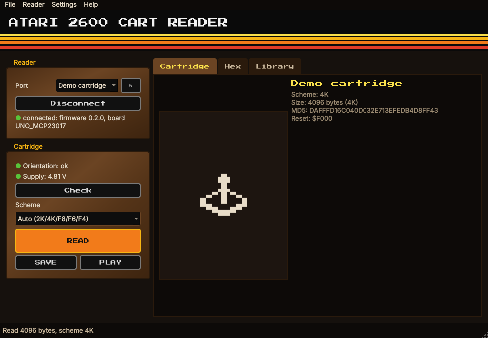

# PC program

Reads a cartridge through the reader, shows it in hex, saves it to a game collection and starts it in
[Stella](https://stella-emu.github.io/). Windows and Linux, Python 3.10+ with PySide6 (Qt, LGPL).



## Start

Short way: `./start.sh` (Linux) or `start.bat` (Windows) in this folder. The first start creates the venv and installs the requirements, every later start runs the program right away; arguments are passed on (`./start.sh --demo`). On Linux, `sudo apt install python3-venv libxcb-cursor0` is still needed once.

By hand, Linux (Debian/Ubuntu refuse a system-wide pip install), once in this folder:

```
sudo apt install python3-venv libxcb-cursor0   # libxcb-cursor0: needed by Qt 6.5+ on X11
python3 -m venv .venv
.venv/bin/pip install -r requirements.txt
```

Windows: `py -m venv .venv` and `.venv\Scripts\pip install -r requirements.txt`. Then start with the
Python of the venv (`.venv/bin/python` or `.venv\Scripts\python`):

```
python -m acr            # GUI
python -m acr --demo     # GUI with a simulated reader and a demo cartridge (no hardware needed)
python -m acr.cli /dev/ttyACM0 read game.a26          # command line, scheme detected automatically
python -m acr.cli COM3 read game.a26 E0               # command line, scheme given
```

Ready-made programs (Windows `.exe`, Linux binary) and the firmware for every board are attached to each
[GitHub release](https://github.com/sfambach/arduino-atari2600-cart-reader/releases), built by
[`release.yml`](../.github/workflows/release.yml).

## What it does

| Function | How |
|---|---|
| Connect | picks the serial port, the firmware answers with version and board (protocol 1); a reader that the system renames after a reset (ttyUSB0 → ttyUSB1) is found again by its USB id and reconnected |
| Check | orientation (D2) and supply of the inserted cartridge |
| Read | **Auto** reads once with the F4 hotspots and derives 2K, 4K, F8, F6 or F4 from the repeating banks; other schemes (SC, E0, E7, FA, FE, 3F) are chosen by hand; every dump is checked with CRC-32 |
| Multicart | for cartridges that switch to the next game at every power-on (e.g. 32 in 1): reads game after game, switching the supply off for 0.5 s in between, until the first game comes back; joins them in Stella's `<n>IN1` format and rotates the order until the image matches the game list; in Stella, Ctrl+R starts the next game (confirmed with the 32 in 1, 2026-11-15) |
| Split multicart | File → *Split multicart into the collection*: saves every game of a `<n>IN1` image on its own and looks each one up in the game list by MD5; games not listed (often shortened versions) are named «<multicart>, game <n>». Also works for a 64K file opened from disk (taken as 32IN1) |
| Title and cover | MD5 looked up in the No-Intro list of [libretro-database](https://github.com/libretro/libretro-database), box art from [libretro-thumbnails](https://github.com/libretro-thumbnails/Atari_-_2600); both downloaded on first use and cached, nothing is shipped |
| Hex | read-only, one block per 4K bank, go to address, find bytes, compare with a file |
| Save / collection | the collection keeps every saved ROM with title, scheme and cover; double-click plays it |
| Play | writes the ROM to a temporary file and starts Stella with `-bs <scheme>`; Stella is found on the PATH, in `/usr/games`, as snap or flatpak, in the default Windows folder, or at the path set in the settings; if Stella stops at once, its output is shown |
| Updates | at start (can be switched off) the latest GitHub release is compared with the program and the firmware |
| Firmware update | after connecting, a newer firmware in the latest release is offered ("Update firmware now"); Reader menu: the latest release or a local `.hex`; uploaded by the program itself through the Arduino bootloader (STK500 v1 for Uno/Nano, v2 for the Mega), with verify; no avrdude needed |
| Language | English and German (Settings) |

Data folders: Linux `~/.local/share/AtariCartReader` (collection) and `~/.cache/AtariCartReader` (titles,
covers, temporary ROMs); Windows `%APPDATA%\AtariCartReader` and `%LOCALAPPDATA%\AtariCartReader`.

## Limits

- Live emulation straight from the cartridge is not possible: the 6507 reads the ROM on almost every cycle
  (about 1.19 MHz), far beyond the serial link. The program reads the cartridge once and plays from memory.
- Bankswitched cartridges: reading a hotspot switches the bank, so the hotspot bytes of the other banks show
  the bank they select (as a real 2600 sees them). Such a dump can differ in those few bytes from a reference
  dump read straight from the EPROM, and then the title lookup by MD5 finds nothing (RealSports Tennis matched).
- Confirmed on hardware (Uno MCP23017, 2026-11-15): firmware upload, Stella start, auto detection and title lookup
  with RealSports Tennis (F8, MD5 matches the No-Intro reference).

## Troubleshooting

- **A 4K game is detected as F6 or F4, or the game is unknown:** usually a bad contact. Pull the cartridge out,
  plug it back in firmly and read again (Bobby Is Going Home, 4K, read as F4 until it was re-seated). With a dirty
  contact, single bytes differ from read to read; the detection then takes the copies as different banks. Check:
  set the scheme to 4K, read twice and compare the MD5. Clean the contacts if it keeps changing.

## Tests

```
pip install pytest
QT_QPA_PLATFORM=offscreen python -m pytest -q tests
```

The tests run against the simulated reader (`acr/simulator.py`).

## Licence

GPLv3 like the rest of the repository. Font *Press Start 2P* by CodeMan38, SIL Open Font License 1.1
(`acr/gui/assets/OFL.txt`). The demo cartridge (`acr/demo_rom.py`) is written for this project.
